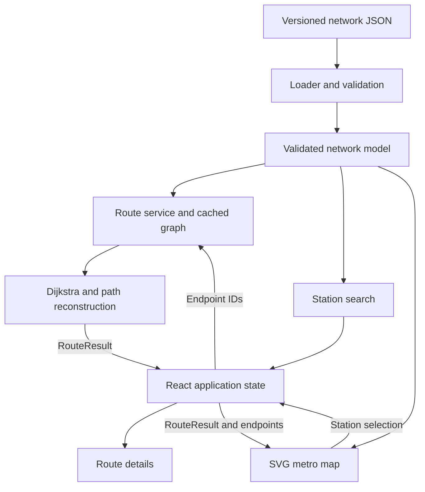

# Interactive Delhi Metro Route Planner and Visualiser

Technical implementation specification for **Project 1**, CS-3810: Design Practices in Computer Science, Ashoka University.

**Team:** LeadsPM

**Repository:** [Project-01-LeadPM](https://github.com/Ashoka-CS-3810-Design-Practices-in-CS/Project-01-LeadPM)

| Team member | Roll number |
| --- | --- |
| Khem Raj Bhatta | 1020241723 |
| Ribence Kadel | 1020231799 |

> This repository currently contains the README only. The sections below specify the website to implement; the proposed source files and commands become available when the application is added. The design follows the team's submitted Assignment 1 and Assignment 2 design materials. A local sample prototype informed the interfaces, but its code and datasets are not included in this commit.

## 1. Objective and scope

Build a browser application in which commuters, visitors, and students can select two Delhi Metro stations, find the fastest route under a documented travel-time model, and understand the journey through an itinerary and an interactive map.

A successful result must show the source, destination, ordered stations, lines used, actual line changes, number of interchanges, and estimated travel time. The map must highlight exactly the route described by the itinerary.

The core requirements are station search and selection, graph-based route finding, interchange detection, route details, interactive visualisation, zoom and pan, station information, reset, and error feedback. The data, algorithms, UI, and map must have separate responsibilities.

The following are team design decisions: a client-side React application, a static versioned dataset, minutes as the route metric, explicit transfer penalties, and the performance targets below. Live train positions, service delays, fares, accounts, payments, and multimodal journeys are outside the baseline. Route comparison, fewest-change routing, favourites, export, animation, and themes are possible extensions.

## 2. Functional requirements

| ID | Feature | Required behaviour |
| --- | --- | --- |
| FR1 | Load the network | Load and validate stations, lines, connections, and transfers; build the graph before enabling route requests. |
| FR2 | Search stations | Match names and station codes, rank suggestions, and show feedback for unknown input. |
| FR3 | Select endpoints | Store valid station IDs for source and destination; show distinct endpoint markers. |
| FR4 | Find the fastest route | Minimise total ride and transfer minutes using the weighted graph; report an unreachable destination. |
| FR5 | Detect interchanges | Record a line change only when the chosen path traverses a transfer edge. |
| FR6 | Present the itinerary | Display ordered stations, line sections, interchange instructions, counts, and estimated time. |
| FR7 | Render the map | Draw the validated network, distinguish interchange stations, and highlight the selected route using shared IDs. |
| FR8 | Navigate the map | Support bounded zoom, pan, and reset view without modifying the route. |
| FR9 | Inspect stations | Show station name, code, serving lines, and interchange status on hover, focus, or selection. |
| FR10 | Start a new route | Clear both endpoints, search text, route details, feedback, and highlights while retaining the loaded network. |
| FR11 | Show status | Distinguish loading, ready, computing, success, no-route, and error states; discard stale results. |

Selecting stations from the map must use the same state and route service as selecting search suggestions. The first map selection sets the source; subsequent selections set the destination until the user starts a new route or edits the source control.

## 3. Technology choices

| Area | Technology | Purpose |
| --- | --- | --- |
| Application | React and TypeScript | Reusable components, explicit domain contracts, and predictable rendering. |
| Build tooling | Vite, Node.js, npm | Local development, dependency management, type checking, and static production builds. |
| Map | SVG, `d3-selection`, `d3-zoom` | Render schematic stations and connections; provide viewport transforms and navigation. |
| Data | Versioned JSON and Zod | Store the network separately from application logic and validate incoming records. |
| Routing | Custom TypeScript graph, indexed binary min-heap, and Dijkstra implementation | Make graph modelling, shortest-path computation, and complexity explicit and independently testable. |
| State | React hooks and `useReducer` | Coordinate endpoint selections, route results, reset actions, and request revisions. |
| Styling | CSS | Responsive layout, route emphasis, focus indicators, and readable controls. |
| Unit/component tests | Vitest, jsdom, React Testing Library, user-event | Check algorithms, contracts, state transitions, and user interactions. |
| Browser tests | Playwright | Verify real SVG behaviour, map navigation, responsive layout, and complete journeys. |
| Version control | Git and GitHub | Reviewable changes and reproducible project history. |

The baseline runs in the browser and needs no application server, database, API key, or external routing service. When adding the application, pin compatible dependencies in `package.json`, commit `package-lock.json`, and document a supported Node.js version. D3 manages the viewport transform; React owns the station and connection elements.

## 4. Architecture and module boundaries



The arrows describe runtime data and requests. The route service owns graph construction and calls the algorithms. Algorithms and graph structures must not import React, D3, DOM APIs, or UI components. The map receives a validated model and a completed result; it does not calculate routes. Both the itinerary and map consume the same `RouteResult` held in application state.

Proposed source layout; these files are implementation targets:

```text
README.md
website/
  package.json
  package-lock.json
  index.html
  tsconfig.json
  vite.config.ts
  scripts/
    browser-check.mjs
  src/
    main.tsx
    App.tsx
    models/
      network.ts
      RouteResult.ts
    data/
      metro-network.json
      schema.ts
      validateNetwork.ts
      loader.ts
    graph/
      Graph.ts
      MinHeap.ts
      buildGraph.ts
    algorithms/
      dijkstra.ts
      reconstructRoute.ts
      detectInterchanges.ts
      stationSearch.ts
    services/
      routeService.ts
    state/
      routeReducer.ts
    components/
      StationSearch.tsx
      RouteControls.tsx
      RouteDetails.tsx
      StatusMessage.tsx
      MetroMap.tsx
    styles/
      app.css
    tests/
      routing.test.ts
      ui.test.tsx
      setup.ts
```

## 5. Network data contract

Use stable IDs for records and all references. Display names may change without changing graph identity. Coordinates are schematic SVG positions, independent of routing weights.

```ts
interface Station {
  id: string;
  name: string;
  code: string;
  lineIds: string[];
  x: number;
  y: number;
  labelDx: number;
  labelDy: number;
}

interface MetroLine {
  id: string;
  name: string;
  color: string;          // Six-digit hexadecimal colour.
  stationIds: string[];   // Ordered stations on one service chain.
}

interface Connection {
  id: string;
  from: string;          // Physical station ID.
  to: string;            // Physical station ID.
  lineId: string;
  minutes: number;
}

interface TransferEdge {
  id: string;
  stationId: string;
  fromLineId: string;
  toLineId: string;
  minutes: number;
}

interface Network {
  version: string;
  kind: "sample" | "verified";
  description: string;
  stations: Station[];
  lines: MetroLine[];
  connections: Connection[];
  transfers: TransferEdge[];
}

interface NetworkModel {
  data: Network;
  stations: Map<string, Station>;
  lines: Map<string, MetroLine>;
}
```

### Validation rules

Validate the schema first, then relationships between records:

1. Require non-empty version, names, codes, and descriptions; use a consistent ID format such as lowercase letters, digits, and hyphens.
2. Require unique station IDs, line IDs, and edge IDs; compare station codes without case sensitivity. Connection and transfer IDs must also be unique across both edge collections.
3. Require finite coordinates and label offsets, valid line colours, and at least one line membership per station.
4. Reject duplicate memberships and repeated stations within a line chain. Every station and line reference must exist, and memberships must agree in both directions.
5. Require exactly one travel record for each adjacent station pair in each line chain. Reject self-loops, missing links, non-adjacent links, and duplicate undirected pairs on the same line.
6. Accept only finite, non-negative travel minutes. Require finite, strictly positive transfer minutes so changing lines incurs a cost.
7. Require each transfer to connect two different lines at a station served by both lines. Reject duplicate transfer pairs at the same station.
8. Treat a missing transfer record as an unavailable direct line change. Shared station membership alone must not create a transfer edge.
9. Permit disconnected components and handle them through a no-route result; never fabricate a connection to make the network reachable.

Store dataset provenance, source references, review date, timing assumptions, and version-change notes with the eventual dataset documentation. Passing structural validation does not establish that real-world topology or timings are correct. Mark data `verified` only after that review.

The local development fixture has 22 physical stations across 4 lines with illustrative timing and geometry. If reused, label it as a sample in both the UI and documentation. Acquiring and checking the full approved network is a separate implementation task.

## 6. Graph model and data structures

Each routing vertex is a **station and line pair**, identified as `stationId|lineId`. For example, `rajiv-chowk|yellow` and `rajiv-chowk|blue` represent different states at the same physical station. A travel edge stays on a line; a transfer edge changes lines at the same station.

```text
New Delhi / Yellow --ride--> Rajiv Chowk / Yellow
                                  |
                            transfer minutes
                                  |
                            Rajiv Chowk / Blue --ride--> R. K. Ashram Marg / Blue
```

The baseline dataset treats travel and transfers as bidirectional. Build two directed adjacency entries for each record, retaining the original record ID for reconstruction and highlighting.

| Structure | Contents and operations | Expected cost |
| --- | --- | --- |
| Station/line maps | Resolve stable IDs to records. | Expected constant-time lookup. |
| Node map | Resolve a state ID to its station and line. | Expected constant-time lookup. |
| Adjacency list | Map a state to its outgoing weighted edges. | `O(V + E)` storage; neighbour iteration proportional to degree. |
| Station-state index | Map each physical station to its line states. | Lookup plus iteration over that station's memberships. |
| Indexed binary min-heap | Insert, decrease a state's priority, and extract the minimum. | `O(log V)` per update/extraction; `O(V)` space. |
| Distance map | Best known minutes to each state. | Expected constant-time read/update. |
| Predecessor map | Previous selected edge for each improved state. | Expected constant-time read/update. |
| Settled set | States whose shortest distance is final. | Expected constant-time membership/update. |
| Highlight sets | Route station and connection IDs used by the renderer. | Expected constant-time membership. |

Here `V` counts station-line states, not physical stations, and `E` counts directed adjacency entries including transfers. With `C` travel records and `T` transfer records, the baseline has `E = 2(C + T)`. Map/Set costs assume expected hashing performance and bounded ID sizes.

The initial line schema represents one chain per line. Branches require distinct service-line IDs with explicitly justified transitions, or an extension to the topology schema and validator. Direction-specific service requires directed data and a corresponding graph-builder change. These extensions must be designed before importing a network that needs them.

## 7. Routing algorithms and cost model

### Fastest route

Minimise:

```text
totalTravelTime = sum(selected travel-edge minutes)
                + sum(selected transfer-edge minutes)
```

Boarding any line at the source and exiting at the destination incur no additional cost. Waiting times, delays, and timetable effects are not modelled separately. Reject identical source and destination IDs before searching, as specified in the submitted Assignment 1.

Use Dijkstra's algorithm with a custom indexed binary min-heap. Keep at most one active heap entry per state and support decrease-key. Order equal priorities by state ID and replace predecessors only for strictly better costs, producing repeatable results for a fixed dataset. Equal-time routes do not have a secondary fewest-interchange objective.

```text
findPath(graph, sourceStation, destinationStation):
    distance = map with default infinity
    previous = empty map
    settled = empty set
    queue = empty indexed min-heap

    for state in graph.stationStates[sourceStation]:
        distance[state] = 0
        queue.insertOrDecrease(state, 0)

    while queue is not empty:
        current, minutes = queue.extractMin()
        add current to settled
        if graph.nodes[current].stationId == destinationStation:
            return current, minutes, previous

        for edge in graph.adjacency[current]:
            if edge.to is in settled:
                continue
            candidate = minutes + edge.minutes
            reject a non-finite candidate
            if candidate < distance[edge.to]:
                distance[edge.to] = candidate
                previous[edge.to] = edge
                queue.insertOrDecrease(edge.to, candidate)

    return no-route
```

Non-negative weights ensure that an extracted minimum-distance state is final. Initialising all source states at zero is equivalent to a virtual source with zero-cost boarding edges. The first settled destination state is therefore the cheapest valid arrival across its lines.

BFS minimises edge count and cannot correctly optimise unequal minutes. An adjacency matrix uses unnecessary space for a sparse network. Bellman-Ford supports negative weights that this model rejects. A* would require an admissible time heuristic; schematic map distances do not provide one automatically.

### Reconstruction and interchange detection

Follow predecessor **edges** backward from the destination state, then reverse the sequence. Use travel edges to build ordered physical stations and consecutive line segments. Use transfer edges to build interchange instructions and transfer totals. Passing through a multi-line station without taking a transfer must not increment the interchange count.

Do not add a second physical-station entry solely for a transfer. Preserve legitimate later revisits to a station; globally deduplicating the itinerary would lose route order. Verify that ride minutes plus transfer minutes equal the total route cost, allowing a small numeric tolerance if fractional minutes are used.

### Station matching

Trim queries, collapse repeated whitespace, and compare lowercase names and codes. Scan stations into stable buckets: exact matches, prefix matches, then substring matches. Preserve dataset order within each bucket. Empty input may show all stations; unmatched input shows a clear message. A suggestion must be explicitly selected before its ID becomes an endpoint. Fuzzy matching is optional.

### Complexity

| Operation | Time | Additional space |
| --- | --- | --- |
| Validate/build a valid network | `O(V + E)` under bounded record/string sizes and expected hash operations | `O(V + E)` |
| Dijkstra, worst case | `O((V + E) log V)` | `O(V)` beyond the graph |
| Reconstruct and detect transfers | `O(K)` for `K` selected path edges | `O(K)` |
| Ranked station search | `O(N)` record comparisons, plus normalisation and string-matching costs | `O(N)` suggestions |
| Build route highlight sets | `O(K)` | `O(K)` |
| Render the network | `O(N + C)` element traversal, plus browser layout/painting | `O(N + C)` elements |

`N` is the physical-station count. Dijkstra may terminate early for nearby endpoints; its actual work depends on visited states and edges. A useful average-case bound requires a specified graph/query distribution. Validation of a complete valid dataset and reconstruction of a `K`-edge route require linear scans. Algorithmic complexity alone does not guarantee UI latency.

## 8. Service and route-result contracts

The data loader returns `Promise<NetworkModel>`. `createRouteService(model)` builds the graph once and exposes `find(sourceId, destinationId)`. Treat the model and cached graph as read-only during requests.

```ts
interface RouteSegment {
  lineId: string;
  stationIds: string[];
  connectionIds: string[];
  minutes: number;
}

interface InterchangeInstruction {
  stationId: string;
  fromLineId: string;
  toLineId: string;
  minutes: number;
  transferId: string;
}

interface RouteResult {
  sourceId: string;
  destinationId: string;
  stationIds: string[];
  connectionIds: string[];
  segments: RouteSegment[];
  interchanges: InterchangeInstruction[];
  totalTravelTime: number;
  rideMinutes: number;
  transferMinutes: number;
  interchangeCount: number;
}

type RouteOutcome =
  | { status: "success"; route: RouteResult }
  | { status: "error" | "no-route"; message: string };
```

Validate missing, unknown, and identical endpoint IDs at the service boundary even when the UI already validates them. Convert calculation failures into a controlled outcome. The UI resolves record IDs to names through the shared model and never reconstructs a different route itself.

## 9. UI, state, and interaction requirements

Use a desktop layout with a search/details panel beside the map and a stacked layout on narrow screens. Display a clear sample-data notice whenever illustrative data is loaded.

- **Search controls:** labelled From/To comboboxes with name/code suggestions, line information, keyboard navigation, Enter selection, Escape dismissal, and no-match feedback. Editing selected text immediately invalidates the stored station ID.
- **Route controls:** a Find fastest route action and New route action. Disable routing while loading, while a request is active, or when an endpoint is missing; explain invalid/equal selections clearly.
- **Route details:** source and destination, total estimated minutes, ride/transfer breakdown, interchange count, ordered stations grouped by line, and instructions such as "Change at Rajiv Chowk from Yellow Line to Blue Line."
- **Map:** line names and colours, station labels, interchange rings, separate source/destination markers, selected connections, and reduced emphasis for other connections. Derive route highlighting from result IDs rather than pixel proximity.
- **Navigation:** zoom in/out, wheel or touch interaction, drag-to-pan, bounded transforms, and Reset view. Reset view changes only the viewport; New route clears route state.
- **Accessibility:** visible focus, meaningful labels, keyboard-operable stations and map controls, text as well as colour for lines, and status announcements. Make the itinerary usable without operating the map.

Track `sourceId`, `destinationId`, `route`, `status`, `message`, a selection `revision`, and a `resetVersion` used to clear search text. Keep initial network loading/error state separate from route-request state.

On every endpoint edit or reset, increment the revision and clear the old route and highlights immediately. A request captures its revision; apply its outcome only when that revision still matches current state. Reset must also invalidate outstanding work. If the dataset is replaced, invalidate requests and rebuild the service before accepting further results.

Loading the dataset is asynchronous. Scheduling a synchronous calculation with a timer does not move it off the browser's main thread. Add a Web Worker only if measurements justify it, and retain the same revision checks for worker responses.

## 10. Error handling

| Case | Detection | Required response |
| --- | --- | --- |
| Unknown search text | No matching station records | Show "No matching station found" and leave the endpoint unselected. |
| Missing endpoint | Null/empty source or destination ID | Request both selections; do not run Dijkstra. |
| Unknown endpoint ID | ID absent from the validated model | Ask the user to choose a valid suggestion. |
| Identical endpoints | Equal source and destination IDs | Explain that the stations must differ; do not compute a route. |
| Unreachable destination | Queue empties before a destination state is settled | Show a no-route message and retain the endpoints for editing. |
| Loading failure | Loader rejects | Show a data-unavailable message and retry action; keep routing disabled. |
| Invalid network | Schema/semantic validation fails | Reject the dataset as a whole; show readable feedback and keep diagnostic details for development. |
| Invalid numeric result | Accumulated cost is non-finite | Return a calculation error instead of displaying an invalid time. |
| Excessive map movement | Requested transform exceeds limits | Clamp the transform and keep Reset view available. |
| Stale completion | Request revision differs from current revision | Ignore it and retain the current selection state. |

Render input and data labels as text. Do not evaluate search input or insert dataset strings as raw HTML. Remove event handlers and cancel or ignore obsolete asynchronous work when components unmount.

## 11. Quality and performance targets

The team targets a route visible within **1 second** of a valid request and suggestions within roughly **200 ms**, with smooth map navigation. These are implementation goals, not measured guarantees for this repository.

Measure input-to-result and input-to-suggestion latency, including React rendering, on a documented dataset, browser, and representative desktop/mobile device. Record dataset size, environment, and results. Check map responsiveness separately from algorithm timing. Reuse the graph and lookup indexes; introduce worker execution or rendering optimisations based on evidence.

The final UI must avoid horizontal overflow on narrow screens, support keyboard route planning, and be checked for contrast, focus visibility, readable labels, touch usability, and status announcements. Network expansion within the supported topology should require data changes without station-specific changes to Dijkstra.

## 12. Testing and acceptance criteria

### Data and algorithm tests

- Valid fixtures, duplicate IDs/codes, unknown references, inconsistent memberships, missing/non-adjacent connections, invalid colours/coordinates, and illegal transfer pairs.
- Negative/non-finite weights, zero travel cost, rejection of zero transfer cost, disconnected components, and a missing transfer between co-located lines.
- Heap ordering, decrease-key, deterministic equal-priority handling, and at most one active entry per state.
- Same-line, one-transfer, and multi-transfer routes; both directions; correct station order, edge IDs, segments, times, and interchange instructions.
- Free initial boarding, correct destination handling, no charge for passing an interchange on the same line, and route changes when transfer penalties increase.
- Missing, unknown, equal, and unreachable endpoints, plus large costs that exceed the supported numeric range.
- Compare every distinct source/destination pair on small fixtures against an independently implemented Floyd-Warshall oracle over the expanded graph. Review graph construction separately so a shared builder bug cannot be hidden by agreement between algorithms.

If the 22-station local fixture is imported unchanged, it yields 462 distinct ordered station pairs. One fixture check is New Delhi to R. K. Ashram Marg: 8 illustrative minutes, including a 4-minute transfer at Rajiv Chowk. These numbers describe that sample only.

### UI and browser tests

- Search by full/partial name and code; explicitly select suggestions by keyboard and pointer.
- Plan a route using search fields and repeat using map selections.
- Verify that highlighted connection IDs exactly match the itinerary result, including the lines used through an interchange.
- Edit an endpoint after success and confirm both route views clear immediately.
- Reset during an outstanding request and confirm the old completion cannot restore a route.
- Exercise loading failures, retry, invalid selections, no-route feedback, and network inspection before any route is selected.
- Verify zoom/pan boundaries and reset view preserve selected route data.
- Check keyboard focus, screen-reader announcements, narrow layouts, touch interactions, and absence of uncaught browser errors.

Acceptance requires valid minimum-time paths, correctly charged transfers, agreement between text and map, safe handling of invalid data/input, and documented results for the quality targets. Sample tests alone do not establish correctness or usability on the full network.

## 13. Development and deployment plan

After the `website/` application and its package files are committed, provide these commands:

```sh
git clone https://github.com/Ashoka-CS-3810-Design-Practices-in-CS/Project-01-LeadPM.git
cd Project-01-LeadPM/website
npm ci
npm run dev
```

Open the local address printed by the development server. Define package scripts for:

```sh
npm test              # Unit and component tests
npm run build        # TypeScript checks and production build
npm run preview      # Serve the production build locally
npm run test:browser # Browser acceptance checks
```

These commands are planned interfaces and cannot run from the current README-only checkout. Document browser installation, the required server URL, and output locations when adding the browser script. Prefer a reproducible Playwright browser setup over a machine-specific executable path.

For deployment, publish the production output from `website/dist/` to a static host. If using GitHub Pages under this repository name, configure Vite's base path as `/Project-01-LeadPM/` and verify assets and dataset loading at that path. Add CI to install locked dependencies, run unit/component tests and the build, and run browser checks in a configured browser environment before deployment.

Keep generated dependencies, build output, and test artifacts out of source commits. Document the deployed URL, dataset version, data provenance, known limitations, and measured validation results when a deployment exists.

## 14. Implementation milestones

The checklist tracks work to deliver in this repository; it does not claim that local prototype work has been published.

- [ ] Scaffold the React/TypeScript/Vite application, styles, package scripts, and lockfile.
- [ ] Define domain contracts, the versioned JSON format, loader, and complete validation rules.
- [ ] Implement the station-line graph and indexed binary min-heap.
- [ ] Implement and independently verify Dijkstra, reconstruction, and interchange detection.
- [ ] Add the route-service boundary and shared route-result contract.
- [ ] Build station search, endpoint controls, reducer state, feedback, and route details.
- [ ] Implement the SVG map, station interaction, highlighting, bounded pan/zoom, and reset.
- [ ] Complete unit, component, browser, and stale-result acceptance checks.
- [ ] Obtain and review the full approved network, transfer rules, timing provenance, and schematic geometry; extend topology support where needed.
- [ ] Benchmark the full network and complete accessibility and mobile checks.
- [ ] Configure CI, build and verify a static deployment, and update setup documentation with actual evidence.
